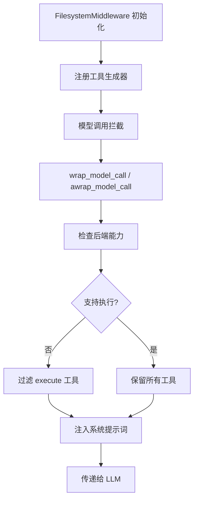

# Simple-Agents 工具清单

> **文档版本**：1.0  
> **更新日期**：2025-01-15  
> **入口文件**：`graph.py`

---

## 📋 目录

- [自定义工具](#自定义工具)
- [内置文件系统工具](#内置文件系统工具)
- [中间件自动工具](#中间件自动工具)
- [工具传递机制](#工具传递机制)
- [Context 传递说明](#context-传递说明)

---

## 自定义工具

这些工具在 `core/tools/` 目录中定义，通过 `graph.py` 的 `tools` 参数显式传递给 Agent。

---

### 1. think_tool - 战略反思工具

| 属性 | 内容 |
|------|------|
| **工具名称** | `think_tool` |
| **功能描述** | 用于研究进度和决策的战略反思工具。在每次搜索后使用此工具，系统地分析结果并规划下一步。 |
| **文件位置** | `core/tools/think.py` |
| **函数签名** | `think_tool(reflection: str) -> str` |
| **装饰器** | `@tool(parse_docstring=True)` |
| **参数** | `reflection` (str)：您对研究进度、发现、缺口和下一步的详细反思 |
| **返回值** | `str`：确认反思已被记录的字符串 |
| **使用场景** | - 收到搜索结果后<br>- 决定下一步之前<br>- 评估研究缺口时<br>- 结束研究之前 |
| **传递方式** | 通过 `create_deep_agent(tools=[think_tool, ...])` 显式传递 |

**代码位置**：
```path/to/core/tools/think.py#L9-30
@tool(parse_docstring=True)
def think_tool(reflection: str) -> str:
    """用于研究进度和决策的战略反思工具"""
    return f"反思已记录: {reflection}"
```

---

### 2. fetch_markdown - 网页获取工具

| 属性 | 内容 |
|------|------|
| **工具名称** | `fetch_markdown` |
| **功能描述** | 从 URL 获取内容并将 HTML 转换为 Markdown 格式，使 HTML 内容易于阅读和处理。 |
| **文件位置** | `core/tools/fetch.py` |
| **函数签名** | `fetch_markdown(url: str, timeout: int = 30) -> dict[str, Any]` |
| **装饰器** | `@tool(parse_docstring=True, return_direct=True)` |
| **参数** | - `url` (str)：要获取的 URL<br>- `timeout` (int)：请求超时时间（秒），默认 30 |
| **返回值** | `dict`：<br>- `success`: 请求是否成功<br>- `url`: 重定向后的最终 URL<br>- `markdown_content`: 转换后的 Markdown 内容<br>- `status_code`: HTTP 状态码<br>- `content_length`: Markdown 内容字符长度 |
| **特性** | - 自动跟随重定向<br>- 使用 User-Agent 伪装<br>- 支持 HTML 转 Markdown |
| **传递方式** | 通过 `create_deep_agent(tools=[fetch_markdown, ...])` 显式传递 |

**代码位置**：
```path/to/core/tools/fetch.py#L8-47
@tool(parse_docstring=True, return_direct=True)
def fetch_markdown(url: str, timeout: int = 30) -> dict[str, Any]:
    """从 URL 获取内容并将 HTML 转换为 Markdown 格式"""
    # ... 实现代码
```

---

### 3. convert_pdf_to_markdown - PDF 转换工具

| 属性 | 内容 |
|------|------|
| **工具名称** | `convert_pdf_to_markdown` |
| **功能描述** | 将 PDF 文件转换为 Markdown 格式，保留标题、段落、图片和其他格式。 |
| **文件位置** | `core/tools/converts.py` |
| **函数签名** | `convert_pdf_to_markdown(pdf_path: str, sandbox_sessions_dir: str = None) -> dict[str, Any]` |
| **装饰器** | `@tool(parse_docstring=True)` |
| **参数** | - `pdf_path` (str)：PDF 文件路径<br>- `sandbox_sessions_dir` (str, optional)：沙箱目录 |
| **返回值** | `dict`：<br>- `success`: 转换是否成功<br>- `pdf_path`: PDF 文件的虚拟路径<br>- `output_file`: 生成的 Markdown 文件路径<br>- `content_length`: 转换后内容长度<br>- `images_extracted`: 提取的图片数量<br>- `error`: 错误信息（如有） |
| **特性** | - 幂等性（已存在的文件直接返回）<br>- 自动提取图片到 `images/` 子目录<br>- 根据字体检测标题 |
| **传递方式** | 通过 `create_deep_agent(tools=[convert_pdf_to_markdown, ...])` 显式传递 |

**代码位置**：
```path/to/core/tools/converts.py#L26-106
@tool(parse_docstring=True)
def convert_pdf_to_markdown(pdf_path: str, sandbox_sessions_dir: str = None) -> dict[str, Any]:
    """将 PDF 文件转换为 Markdown 格式"""
    # ... 实现代码
```

---

### 4. convert_docx_to_markdown - DOCX 转换工具

| 属性 | 内容 |
|------|------|
| **工具名称** | `convert_docx_to_markdown` |
| **功能描述** | 将 Word 文档（DOCX）转换为 Markdown 格式，保留标题、段落、列表、表格和其他格式。 |
| **文件位置** | `core/tools/converts.py` |
| **函数签名** | `convert_docx_to_markdown(docx_path: str, sandbox_sessions_dir: str = None) -> dict[str, Any]` |
| **装饰器** | `@tool(parse_docstring=True)` |
| **参数** | - `docx_path` (str)：DOCX 文件路径<br>- `sandbox_sessions_dir` (str, optional)：沙箱目录 |
| **返回值** | `dict`：<br>- `success`: 转换是否成功<br>- `docx_path`: DOCX 文件的虚拟路径<br>- `output_file`: 生成的 Markdown 文件路径<br>- `content_length`: 转换后内容长度<br>- `messages`: 转换过程中的消息列表<br>- `error`: 错误信息（如有） |
| **特性** | - 保留标题、段落、列表、表格<br>- 幂等性<br>- 自动处理图片 |
| **传递方式** | 通过 `create_deep_agent(tools=[convert_docx_to_markdown, ...])` 显式传递 |

**代码位置**：
```path/to/core/tools/converts.py#L109-186
@tool(parse_docstring=True)
def convert_docx_to_markdown(docx_path: str, sandbox_sessions_dir: str = None) -> dict[str, Any]:
    """将 Word 文档转换为 Markdown 格式"""
    # ... 实现代码
```

---

## 内置文件系统工具

这些工具由 `FilesystemMiddleware` 自动提供，无需显式声明。所有文件路径必须以 `/` 开头。

---

### 5. ls - 列出目录内容

| 属性 | 内容 |
|------|------|
| **工具名称** | `ls` |
| **功能描述** | 列出指定目录中的文件和子目录。 |
| **提供者** | `FilesystemMiddleware` |
| **生成器位置** | `deepagents/middleware/filesystem.py#L313-351` |
| **生成器函数** | `_ls_tool_generator` |
| **参数** | - `path` (str)：目录路径（必须以 `/` 开头） |
| **返回值** | 目录内容列表 |
| **系统提示词** | "list files in a directory (requires absolute path)" |
| **自动注入** | ✅ 是，由 `FilesystemMiddleware` 自动注入 |

---

### 6. read_file - 读取文件

| 属性 | 内容 |
|------|------|
| **工具名称** | `read_file` |
| **功能描述** | 读取指定文件的内容，支持分页读取（offset/limit）。 |
| **提供者** | `FilesystemMiddleware` |
| **生成器位置** | `deepagents/middleware/filesystem.py#L354-396` |
| **生成器函数** | `_read_file_tool_generator` |
| **参数** | - `path` (str)：文件路径<br>- `offset` (int, optional)：起始行号<br>- `limit` (int, optional)：读取行数限制 |
| **返回值** | 文件内容 |
| **系统提示词** | "read a file from the filesystem" |
| **特性** | 支持大文件分页读取，避免上下文溢出 |
| **自动注入** | ✅ 是，由 `FilesystemMiddleware` 自动注入 |

---

### 7. write_file - 写入文件

| 属性 | 内容 |
|------|------|
| **工具名称** | `write_file` |
| **功能描述** | 将内容写入指定文件，覆盖现有文件内容。 |
| **提供者** | `FilesystemMiddleware` |
| **生成器位置** | `deepagents/middleware/filesystem.py#L399-471` |
| **生成器函数** | `_write_file_tool_generator` |
| **参数** | - `path` (str)：文件路径<br>- `content` (str)：要写入的内容 |
| **返回值** | 写入结果 |
| **系统提示词** | "write to a file in the filesystem" |
| **自动注入** | ✅ 是，由 `FilesystemMiddleware` 自动注入 |

---

### 8. edit_file - 编辑文件

| 属性 | 内容 |
|------|------|
| **工具名称** | `edit_file` |
| **功能描述** | 编辑指定文件，支持字符串替换操作。 |
| **提供者** | `FilesystemMiddleware` |
| **生成器位置** | `deepagents/middleware/filesystem.py#L474-550` |
| **生成器函数** | `_edit_file_tool_generator` |
| **参数** | - `path` (str)：文件路径<br>- `old_string` (str)：要替换的字符串<br>- `new_string` (str)：新字符串<br>- `replace_all` (bool, optional)：是否替换所有匹配项 |
| **返回值** | 编辑结果 |
| **系统提示词** | "edit a file in the filesystem" |
| **自动注入** | ✅ 是，由 `FilesystemMiddleware` 自动注入 |

---

### 9. glob - 查找文件

| 属性 | 内容 |
|------|------|
| **工具名称** | `glob` |
| **功能描述** | 使用模式匹配查找文件（如 `**/*.py`）。 |
| **提供者** | `FilesystemMiddleware` |
| **生成器位置** | `deepagents/middleware/filesystem.py#L553-589` |
| **生成器函数** | `_glob_tool_generator` |
| **参数** | - `pattern` (str)：文件模式（如 `*.py`、`**/*.txt`）<br>- `path` (str, optional)：搜索路径 |
| **返回值** | 匹配的文件列表 |
| **系统提示词** | "find files matching a pattern (e.g., "**/*.py")" |
| **自动注入** | ✅ 是，由 `FilesystemMiddleware` 自动注入 |

---

### 10. grep - 文件内容搜索

| 属性 | 内容 |
|------|------|
| **工具名称** | `grep` |
| **功能描述** | 在文件中搜索文本模式（支持正则表达式）。 |
| **提供者** | `FilesystemMiddleware` |
| **生成器位置** | `deepagents/middleware/filesystem.py#L592-642` |
| **生成器函数** | `_grep_tool_generator` |
| **参数** | - `pattern` (str)：搜索模式（正则表达式）<br>- `path` (str, optional)：搜索路径 |
| **返回值** | 匹配的行及其上下文 |
| **系统提示词** | "search for text within files" |
| **自动注入** | ✅ 是，由 `FilesystemMiddleware` 自动注入 |

---

### 11. execute - 执行命令

| 属性 | 内容 |
|------|------|
| **工具名称** | `execute` |
| **功能描述** | 在沙箱环境中运行 shell 命令，返回输出和退出代码。 |
| **提供者** | `FilesystemMiddleware` |
| **生成器位置** | `deepagents/middleware/filesystem.py#L668-754` |
| **生成器函数** | `_execute_tool_generator` |
| **参数** | - `command` (str)：要执行的 shell 命令 |
| **返回值** | 命令输出和退出代码 |
| **系统提示词** | "run a shell command in the sandbox (returns output and exit code)" |
| **特性** | - 仅在支持执行的 Backend 中可用<br>- 不支持时会被自动过滤 |
| **自动注入** | ✅ 是，由 `FilesystemMiddleware` 自动注入（条件性） |

---

## 中间件自动工具

这些工具由相应的中间件自动提供，无需显式声明。

---

### 12. write_todos - 待办事项管理

| 属性 | 内容 |
|------|------|
| **工具名称** | `write_todos` |
| **功能描述** | 管理待办事项列表，用于任务规划和跟踪。 |
| **提供者** | `TodoListMiddleware` |
| **导入位置** | `from langchain.agents.middleware import TodoListMiddleware` |
| **使用场景** | - 任务规划<br>- 研究进度管理<br>- 步骤跟踪 |
| **自动注入** | ✅ 是，由 `TodoListMiddleware` 自动注入 |

---

### 13. task - 子代理调用

| 属性 | 内容 |
|------|------|
| **工具名称** | `task` |
| **功能描述** | 调用子代理执行特定任务，实现上下文隔离和专业化任务委托。 |
| **提供者** | `SubAgentMiddleware` |
| **导入位置** | `from deepagents.middleware import SubAgentMiddleware` |
| **使用场景** | - 上下文隔离<br>- 专业化任务委托<br>- 并行研究 |
| **自动注入** | ✅ 是，由 `SubAgentMiddleware` 自动注入 |

---

## 工具传递机制

### 自定义工具传递流程


**代码示例**：
```path/to/graph.py#L87-107
# 导入自定义工具
from core.tools.converts import convert_pdf_to_markdown, convert_docx_to_markdown
from core.tools.fetch import fetch_markdown
from core.tools.think import think_tool

# 主代理工具配置
agent = create_deep_agent(
    name="协调者",
    model=chat_model,
    tools=[
        think_tool, 
        fetch_markdown, 
        convert_pdf_to_markdown, 
        convert_docx_to_markdown
    ],
    # ... 其他参数
)

# 子代理工具配置
sub_agent = SubAgent(
    name="子智能体",
    tools=[think_tool, fetch_markdown],
    # ... 其他参数
)
```

---

### 内置工具传递流程



**工具生成器注册位置**：
```path/to/deepagents/middleware/filesystem.py#L757-765
TOOL_GENERATORS = {
    "ls": _ls_tool_generator,
    "read_file": _read_file_tool_generator,
    "write_file": _write_file_tool_generator,
    "edit_file": _edit_file_tool_generator,
    "glob": _glob_tool_generator,
    "grep": _grep_tool_generator,
    "execute": _execute_tool_generator,
}
```

**模型调用拦截位置**：
```path/to/deepagents/middleware/filesystem.py#L883-928
def wrap_model_call(
    self,
    request: ModelRequest,
    handler: Callable[[ModelRequest], ModelResponse],
) -> ModelResponse:
    # 检查并过滤工具
    # 注入系统提示词
    return handler(request)
```

---

## Context 传递说明

### 重要说明

❌ **代码中没有使用 XML 格式的 `<context>` 标签**

❗ **Context 信息通过系统提示词注入，而不是 XML 标签**

---

### Context Schema 参数

| 属性 | 内容 |
|------|------|
| **参数名称** | `context_schema` |
| **参数类型** | `type[Any] \| None` |
| **默认值** | `None` |
| **定义位置** | `deepagents/graph.py#L41-51` |
| **用途** | 定义 Agent 的状态结构 |
| **传递方式** | 通过 `create_agent` 函数 |
| **当前状态** | 在 `graph.py` 中**未使用** |

**代码位置**：
```path/to/deepagents/graph.py#L41-51
def create_deep_agent(
    # ...
    context_schema: type[Any] | None = None,
    # ...
):
    return create_agent(
        # ...
        context_schema=context_schema,
        # ...
    )
```

---

### 系统提示词中的 Context

中间件通过拦截模型调用，动态注入上下文信息到系统提示词中。

#### 文件系统工具上下文

**定义位置**：`deepagents/middleware/filesystem.py#L278-288`

```path/to/deepagents/middleware/filesystem.py#L278-288
FILESYSTEM_SYSTEM_PROMPT = """## Filesystem Tools `ls`, `read_file`, `write_file`, `edit_file`, `glob`, `grep`

You have access to a filesystem which you can interact with using these tools.
All file paths must start with a /.

- ls: list files in a directory (requires absolute path)
- read_file: read a file from the filesystem
- write_file: write to a file in the filesystem
- edit_file: edit a file in the filesystem
- glob: find files matching a pattern (e.g., "**/*.py")
- grep: search for text within files"""
```

#### 执行工具上下文

**定义位置**：`deepagents/middleware/filesystem.py#L290-295`

```path/to/deepagents/middleware/filesystem.py#L290-295
EXECUTION_SYSTEM_PROMPT = """## Execute Tool `execute`

You have access to an `execute` tool for running shell commands in a sandboxed environment.
Use this tool to run commands, scripts, tests, builds, and other shell operations.

- execute: run a shell command in the sandbox (returns output and exit code)"""
```

#### 注入流程

**代码位置**：`deepagents/middleware/filesystem.py#L915-928`

```path/to/deepagents/middleware/filesystem.py#L915-928
# 构建动态系统提示词
prompt_parts = [FILESYSTEM_SYSTEM_PROMPT]

# 添加执行工具说明（如果可用）
if has_execute_tool and backend_supports_execution:
    prompt_parts.append(EXECUTION_SYSTEM_PROMPT)

system_prompt = "\n\n".join(prompt_parts)

# 注入到模型请求
if system_prompt:
    request = request.override(
        system_prompt=request.system_prompt + "\n\n" + system_prompt
        if request.system_prompt else system_prompt
    )
```

---

### 用户自定义系统提示词

**定义位置**：`graph.py#L29-40`

```path/to/graph.py#L29-40
INSTRUCTIONS = (
    AGENT_WORKFLOW_INSTRUCTIONS.format(date=current_date)
    + "\n\n"
    + "=" * 80
    + "\n\n"
    + SUBAGENT_DELEGATION_INSTRUCTIONS.format(
        max_concurrent_research_units=max_concurrent_research_units,
        max_researcher_iterations=max_researcher_iterations,
    )
)
```

**组合方式**：
```path/to/deepagents/graph.py#L152-162
return create_agent(
    model,
    system_prompt=system_prompt + "\n\n" + BASE_AGENT_PROMPT 
        if system_prompt else BASE_AGENT_PROMPT,
    # ...
)
```

---

## 附录：工具汇总表

| # | 工具名称 | 类型 | 提供者 | 传递方式 | 功能说明 | 自动注入 |
|---|---------|------|--------|---------|----------|---------|
| 1 | `think_tool` | 自定义 | `core/tools/think.py` | 显式传递 | 用于研究进度和决策的战略反思工具 | ❌ |
| 2 | `fetch_markdown` | 自定义 | `core/tools/fetch.py` | 显式传递 | 从 URL 获取内容并将 HTML 转换为 Markdown | ❌ |
| 3 | `convert_pdf_to_markdown` | 自定义 | `core/tools/converts.py` | 显式传递 | 将 PDF 文件转换为 Markdown，保留标题、段落、图片 | ❌ |
| 4 | `convert_docx_to_markdown` | 自定义 | `core/tools/converts.py` | 显式传递 | 将 DOCX 文件转换为 Markdown，保留标题、段落、表格 | ❌ |
| 5 | `ls` | 内置 | `FilesystemMiddleware` | 自动注入 | 列出指定目录中的文件和子目录 | ✅ |
| 6 | `read_file` | 内置 | `FilesystemMiddleware` | 自动注入 | 读取文件内容，支持分页读取 | ✅ |
| 7 | `write_file` | 内置 | `FilesystemMiddleware` | 自动注入 | 将内容写入指定文件，覆盖现有内容 | ✅ |
| 8 | `edit_file` | 内置 | `FilesystemMiddleware` | 自动注入 | 编辑文件，支持字符串替换操作 | ✅ |
| 9 | `glob` | 内置 | `FilesystemMiddleware` | 自动注入 | 使用模式匹配查找文件（如 `**/*.py`） | ✅ |
| 10 | `grep` | 内置 | `FilesystemMiddleware` | 自动注入 | 在文件中搜索文本模式（支持正则表达式） | ✅ |
| 11 | `execute` | 内置 | `FilesystemMiddleware` | 自动注入 | 在沙箱环境中运行 shell 命令 | ✅ (条件) |
| 12 | `write_todos` | 中间件 | `TodoListMiddleware` | 自动注入 | 管理待办事项列表，用于任务规划和跟踪 | ✅ |
| 13 | `task` | 中间件 | `SubAgentMiddleware` | 自动注入 | 调用子代理执行特定任务，实现上下文隔离 | ✅ |

---

## 附录：关键文件索引

| 文件路径 | 说明 |
|---------|------|
| `graph.py` | 主入口文件，定义 Agent 和工具配置 |
| `core/tools/think.py` | 战略反思工具 |
| `core/tools/fetch.py` | 网页获取工具 |
| `core/tools/converts.py` | PDF/DOCX 转换工具 |
| `deepagents/graph.py` | Deep Agent 创建函数 |
| `deepagents/middleware/filesystem.py` | 文件系统中间件和工具生成器 |
| `core/middleware/attachment_extract.py` | 附件提取中间件 |
| `core/middleware/tool_path_resolver.py` | 工具路径解析中间件 |
| `prompts.py` | 系统提示词定义 |

---

**文档结束** 📄