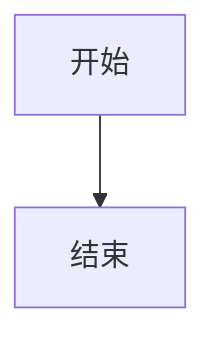
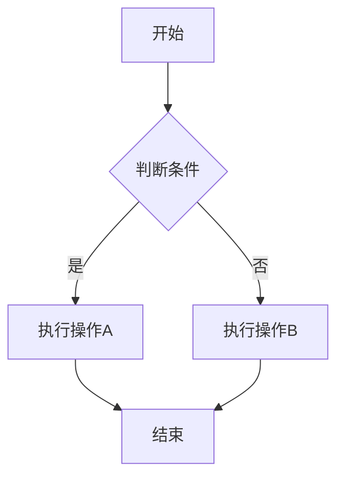
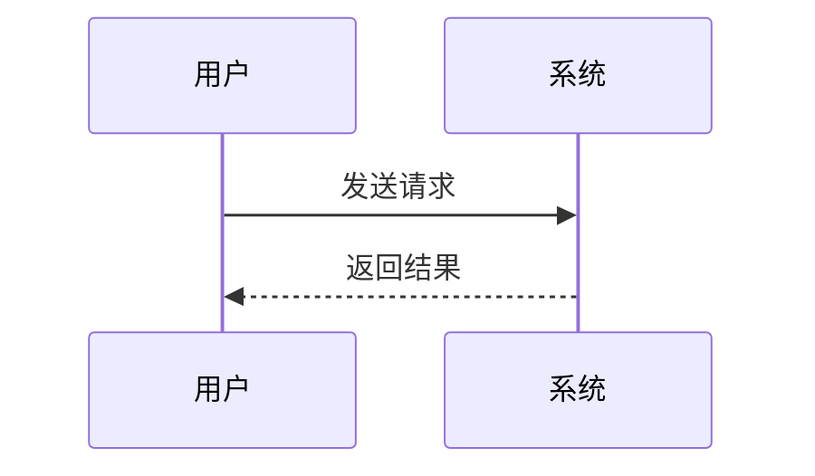

# Flowchart Generator 技能安装完成

## ✅ 安装状态

**技能名称**: flowchart-generator
**版本**: 1.0.0
**安装日期**: 2024-01-08
**状态**: ✅ 安装成功

## 📦 已安装内容

```
/skills/flowchart-generator/
├── SKILL.md                    # 技能说明文档（完整语法参考）
├── README.md                   # 技能介绍和使用指南
├── QUICKSTART.md              # 5分钟快速入门指南
└── examples/                  # 示例文件集合
    ├── basic-flowchart.mmd    # 基础流程图示例
    ├── sequence-diagram.mmd   # 序列图示例
    ├── mindmap.mmd           # 思维导图示例
    ├── gantt-chart.mmd       # 甘特图示例
    ├── class-diagram.mmd     # 类图示例
    └── state-diagram.mmd     # 状态图示例
```

## 🎯 技能功能

这个技能基于 **Mermaid**，支持生成以下类型的图表：

1. **流程图** (Flowchart) - 业务流程、算法流程
2. **序列图** (Sequence Diagram) - API 调用、系统交互
3. **类图** (Class Diagram) - 系统架构、数据模型
4. **思维导图** (Mindmap) - 项目规划、知识整理
5. **甘特图** (Gantt Chart) - 项目计划、时间安排
6. **状态图** (State Diagram) - 状态机、生命周期
7. **实体关系图** (ER Diagram) - 数据库设计
8. **用户旅程图** (User Journey) - 用户体验路径

## 🚀 快速开始

### 方式 1：在线使用（推荐）

访问 **Mermaid Live Editor**: https://mermaid.live

1. 在左侧编辑器输入 Mermaid 语法
2. 右侧实时预览生成的图表
3. 点击 Download 导出为 PNG/SVG

### 方式 2：在 Markdown 中使用

在支持 Mermaid 的编辑器中（Typora、Obsidian、VS Code）：

````markdown

````

### 方式 3：命令行使用

```bash
# 安装 Mermaid CLI
npm install -g @mermaid-js/mermaid-cli

# 转换示例文件
mmdc -i /skills/flowchart-generator/examples/basic-flowchart.mmd -o output.png
```

## 📚 学习路径

### 初学者（5分钟）
1. 阅读 `QUICKSTART.md` - 快速入门指南
2. 访问 https://mermaid.live 在线练习
3. 尝试修改 `examples/` 中的示例

### 进阶用户（30分钟）
1. 阅读 `SKILL.md` - 完整语法参考
2. 学习样式定制和高级特性
3. 创建自己的图表模板

### 高级用户
1. 研究 Mermaid 官方文档
2. 集成到自动化流程
3. 开发自定义主题和插件

## 💡 使用示例

### 创建一个简单的流程图



### 创建一个 API 序列图



## 🔗 相关资源

- **官方文档**: https://mermaid.js.org/
- **在线编辑器**: https://mermaid.live
- **语法参考**: https://mermaid.js.org/syntax/reference.html
- **GitHub**: https://github.com/mermaid-js/mermaid

## 📝 注意事项

1. **编码**: 文件使用 UTF-8 编码以支持中文
2. **复杂度**: 复杂图表建议拆分为多个子图
3. **导出格式**: 推荐使用 SVG 格式以保持清晰度
4. **兼容性**: Mermaid 语法在不同版本间可能有差异

## 🎓 常见应用场景

- ✍️ **技术文档** - 系统架构图、API 流程图
- 📊 **业务文档** - 业务流程图、决策树
- 📅 **项目管理** - 甘特图、思维导图
- 🎓 **教学演示** - 算法流程、概念图
- 💻 **代码设计** - 类图、时序图、状态图

## 🛠️ 技术支持

如遇问题，可以：
1. 查看 `SKILL.md` 中的常见问题部分
2. 访问 Mermaid 官方文档
3. 在 Mermaid Live Editor 中测试语法

---

**安装完成！** 您现在可以开始使用 Mermaid 创建各种图表了。🎉

建议从 `QUICKSTART.md` 开始，5分钟即可上手！
