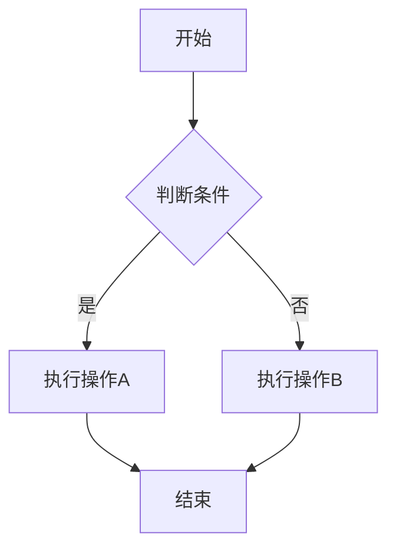
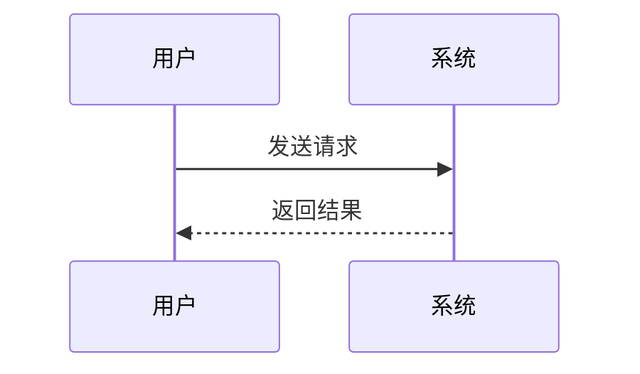
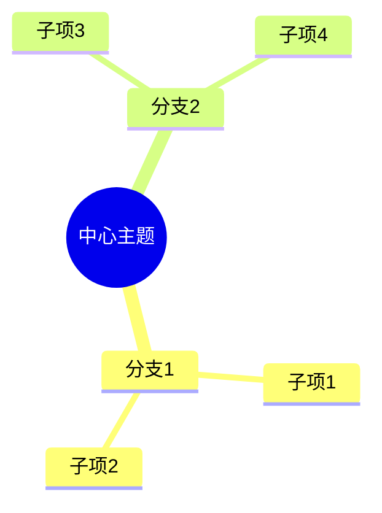
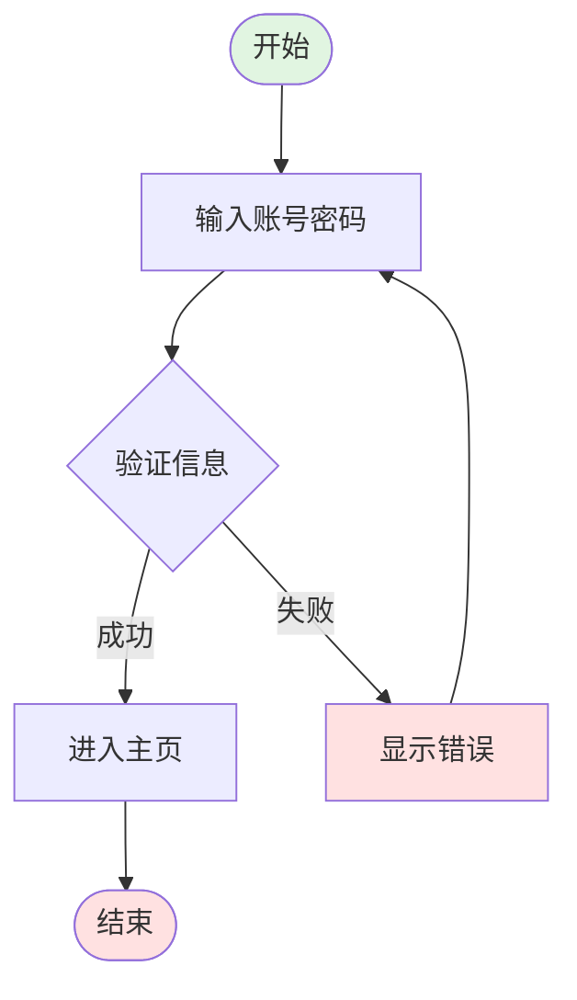
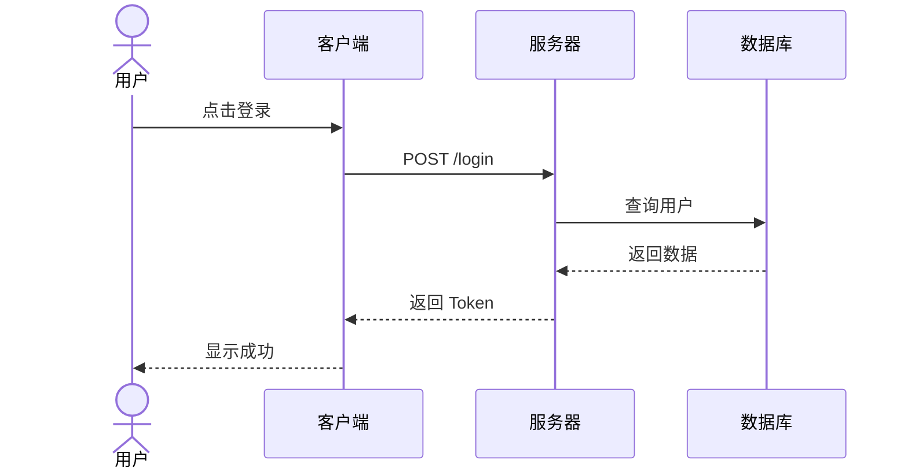
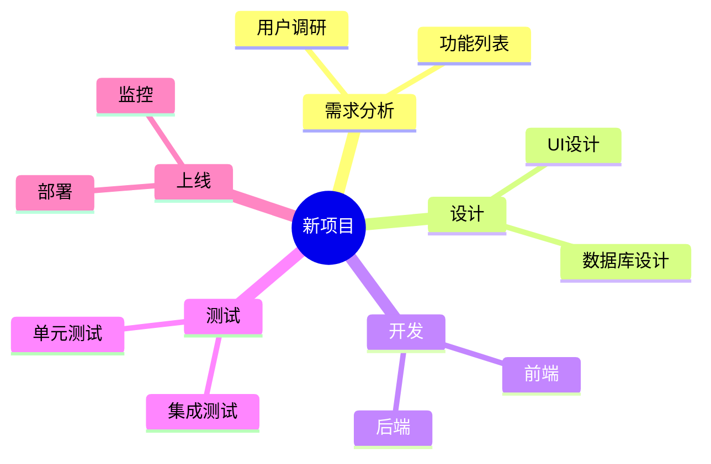
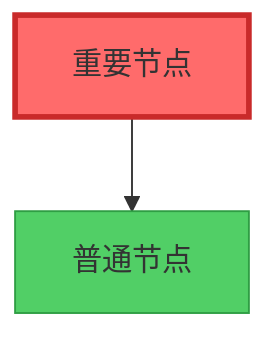
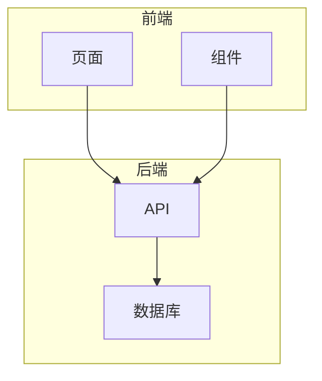

# 快速入门指南

## 5 分钟上手 Mermaid 流程图

### 第一步：选择工具

**推荐使用在线编辑器**：https://mermaid.live

### 第二步：复制模板

选择下面的模板，复制到编辑器中：

#### 📊 流程图（最常用）



#### 🔄 序列图（API 调用）



#### 🧠 思维导图（项目规划）



### 第三步：修改内容

1. 修改节点文字（方括号内的内容）
2. 修改连接关系（箭头）
3. 调整布局方向（TD=从上到下，LR=从左到右）

### 第四步：导出图片

点击 "Download" 按钮，选择：
- **PNG** - 适合插入文档
- **SVG** - 适合网页使用（可缩放）

---

## 常用语法速查

### 节点形状

| 语法 | 形状 | 用途 |
|------|------|------|
| `[文本]` | 矩形 | 普通步骤 |
| `(文本)` | 圆角矩形 | 开始/结束 |
| `{文本}` | 菱形 | 判断条件 |
| `[(文本)]` | 圆柱形 | 数据存储 |
| `[[文本]]` | 子程序 | 函数/方法 |

### 方向控制

| 代码 | 方向 |
|------|------|
| `graph TD` | 从上到下 |
| `graph LR` | 从左到右 |
| `graph RL` | 从右到左 |
| `graph DT` | 从下到上 |

### 连接线

| 语法 | 说明 |
|------|------|
| `-->` | 实线箭头 |
| `--->` | 加粗箭头 |
| `--文字-->` | 带标签的箭头 |
| `-.->` | 虚线箭头 |
| `==>` | 加粗实线 |

---

## 实用示例

### 示例 1：登录流程



### 示例 2：API 调用序列



### 示例 3：项目规划思维导图



---

## 进阶技巧

### 1. 添加样式



### 2. 使用子图



### 3. 添加注释

```mermaid
graph TD
    A[开始] --> B[处理]
    B --> C[结束]
    note right of B
        这是处理步骤
        可以多行注释
    end note
```

---

## 常见问题

**Q: 中文显示乱码？**
A: 确保文件使用 UTF-8 编码保存。

**Q: 图表太大？**
A: 拆分成多个子图，或简化节点内容。

**Q: 如何在 Markdown 中使用？**
A: 用 ```mermaid 和 ``` 包裹语法代码。

**Q: 导出的图片不清晰？**
A: 选择 SVG 格式，或增加 PNG 的 DPI 设置。

---

## 下一步

- 查看 `SKILL.md` 了解完整语法
- 查看 `examples/` 目录学习更多示例
- 访问 https://mermaid.live 在线练习
- 阅读 [官方文档](https://mermaid.js.org/)

**祝您使用愉快！** 🎉
