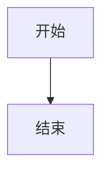
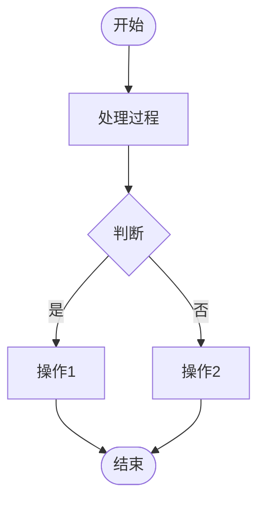
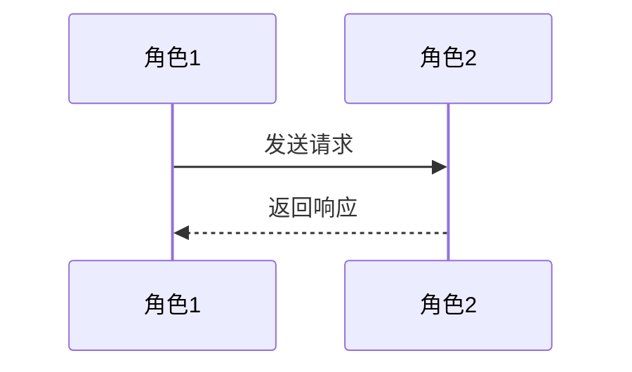
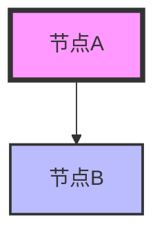

# Flowchart Generator - 流程图生成技能

## 🎯 技能简介

这是一个基于 Mermaid 的流程图生成技能，可以帮助您快速创建各种类型的图表，包括流程图、序列图、思维导图、甘特图等。

## ✨ 主要功能

- ✅ **流程图** - 业务流程、算法流程、决策树
- ✅ **序列图** - API 调用、系统交互、时序图
- ✅ **类图** - 系统架构、数据模型、类关系
- ✅ **思维导图** - 项目规划、知识整理、头脑风暴
- ✅ **甘特图** - 项目计划、时间安排、里程碑
- ✅ **状态图** - 状态机、生命周期、状态转换
- ✅ **实体关系图** - 数据库设计、数据关系
- ✅ **用户旅程图** - 用户体验、用户行为路径

## 🚀 快速开始

### 1. 在线使用（推荐）

访问 [Mermaid Live Editor](https://mermaid.live)：
1. 在左侧编辑器中输入 Mermaid 语法
2. 右侧实时预览生成的图表
3. 可以导出为 SVG 或 PNG 格式

### 2. 在 Markdown 中使用

在支持 Mermaid 的 Markdown 编辑器中（如 Typora、Obsidian、VS Code）：

````markdown

````

### 3. 命令行使用

```bash
# 安装 Mermaid CLI
npm install -g @mermaid-js/mermaid-cli

# 转换文件
mmdc -i input.mmd -o output.png
```

## 📚 示例文件

技能包中包含以下示例文件：

| 文件 | 说明 |
|------|------|
| `basic-flowchart.mmd` | 基础流程图示例 |
| `sequence-diagram.mmd` | 序列图示例（API 调用） |
| `mindmap.mmd` | 思维导图示例（项目规划） |
| `gantt-chart.mmd` | 甘特图示例（项目计划） |
| `class-diagram.mmd` | 类图示例（电商系统） |
| `state-diagram.mmd` | 状态图示例（订单状态） |

## 💡 使用技巧

### 快速模板

**流程图模板：**


**序列图模板：**


### 样式定制



## 📖 语法参考

详细的语法说明请查看 `SKILL.md` 文件，包含：
- 各种图表类型的语法
- 节点形状和样式
- 连接线和箭头
- 子图和分组
- 实用技巧

## 🔗 相关资源

- [Mermaid 官方文档](https://mermaid.js.org/)
- [Mermaid Live Editor](https://mermaid.live)
- [语法参考](https://mermaid.js.org/syntax/reference.html)
- [示例集合](https://mermaid.js.org/intro/)

## 🎓 常见应用场景

1. **技术文档** - 系统架构图、API 流程图
2. **业务文档** - 业务流程图、决策树
3. **项目管理** - 甘特图、思维导图
4. **教学演示** - 算法流程、概念图
5. **代码设计** - 类图、时序图、状态图

## 📝 注意事项

- 使用 UTF-8 编码以支持中文
- 复杂图表建议拆分为多个子图
- 在线编辑器支持实时预览和调试
- 导出时建议使用 SVG 格式以保持清晰度

## 🤝 贡献

欢迎提供更多示例和改进建议！

---

**版本**: 1.0.0
**更新日期**: 2024-01-08
**基于**: Mermaid 11.x
