# Flowchart Generator - 流程图生成技能

## 技能概述

这个技能使用 Mermaid 语法来生成各种类型的图表，包括：
- 流程图 (Flowchart)
- 序列图 (Sequence Diagram)
- 类图 (Class Diagram)
- 状态图 (State Diagram)
- 实体关系图 (ER Diagram)
- 用户旅程图 (User Journey)
- 甘特图 (Gantt Chart)
- 思维导图 (Mindmap)
- 饼图 (Pie Chart)

## 何时使用此技能

当用户需要：
- 创建流程图或流程图
- 绘制序列图或时序图
- 生成思维导图
- 创建类图或架构图
- 绘制甘特图或项目计划
- 生成任何类型的可视化图表

## Mermaid 语法快速参考

### 1. 流程图 (Flowchart)

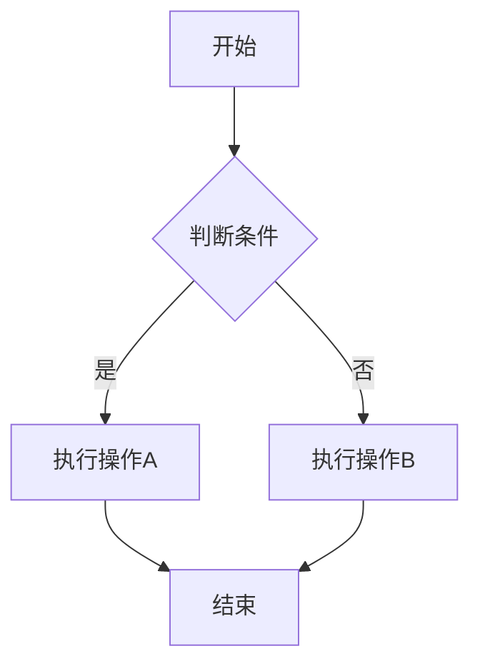

**方向说明：**
- `TD` - 从上到下 (Top to Down)
- `DT` - 从下到上 (Down to Top)
- `LR` - 从左到右 (Left to Right)
- `RL` - 从右到左 (Right to Left)

**形状说明：**
- `[文本]` - 矩形
- `(文本)` - 圆角矩形
- `{文本}` - 菱形（判断）
- `[(文本)]` - 圆柱形
- `[[文本]]` - 子程序

### 2. 序列图 (Sequence Diagram)

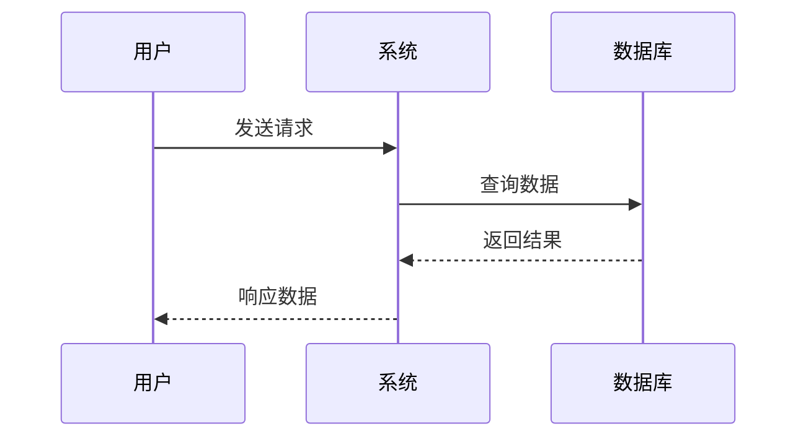

### 3. 类图 (Class Diagram)

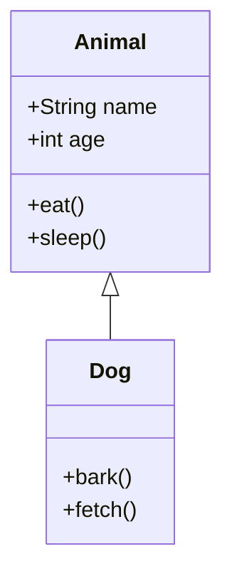

### 4. 思维导图 (Mindmap)

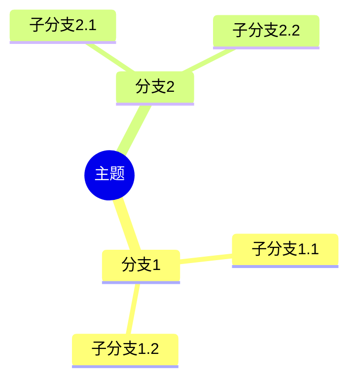

### 5. 甘特图 (Gantt Chart)

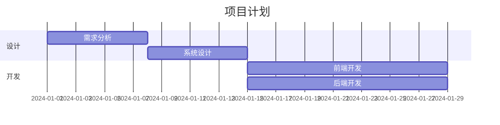

### 6. 状态图 (State Diagram)

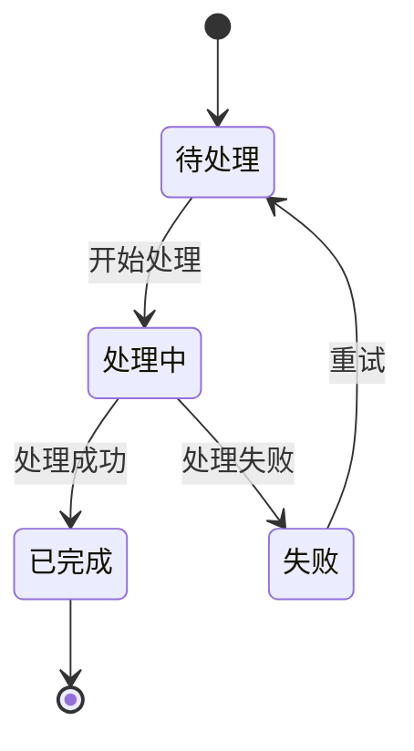

### 7. 实体关系图 (ER Diagram)

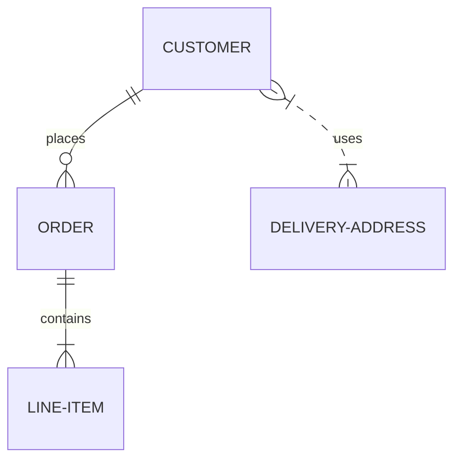

## 使用方法

### 在线渲染（推荐）

1. **Mermaid Live Editor** - https://mermaid.live
   - 实时预览
   - 导出为 SVG/PNG
   - 分享链接

2. **Markdown 编辑器**
   - Typora
   - Obsidian
   - VS Code (with Mermaid 插件)

### 命令行使用

```bash
# 安装 Mermaid CLI
npm install -g @mermaid-js/mermaid-cli

# 将 mmd 文件转换为 PNG
mmdc -i input.mmd -o output.png

# 转换为 SVG
mmdc -i input.mmd -o output.svg

# 指定主题
mmdc -i input.mmd -o output.png -t dark
```

## 实用技巧

### 1. 样式定制

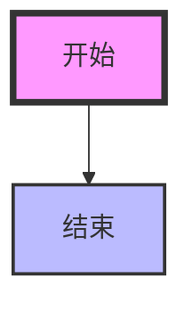

### 2. 子图

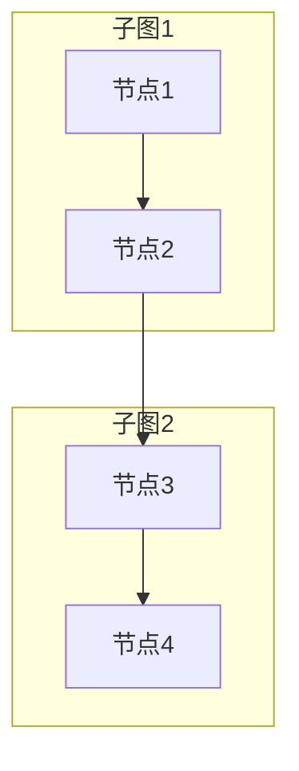

### 3. 链接标签

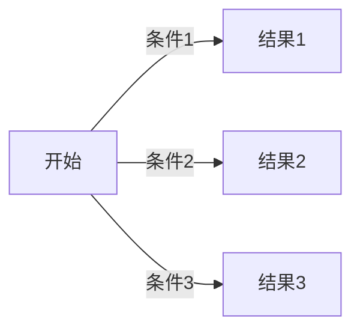

## 常见问题

**Q: 如何调整图表大小？**
A: Mermaid 会自动调整大小。如果需要固定尺寸，可以在导出时指定。

**Q: 支持中文吗？**
A: 完全支持中文，但建议使用 UTF-8 编码。

**Q: 如何在 Markdown 中使用？**
A: 直接使用 ```mermaid 代码块包裹语法即可。

**Q: 图表太复杂怎么办？**
A: 考虑拆分成多个子图，或使用更简洁的表示方式。

## 示例模板

### 业务流程图模板

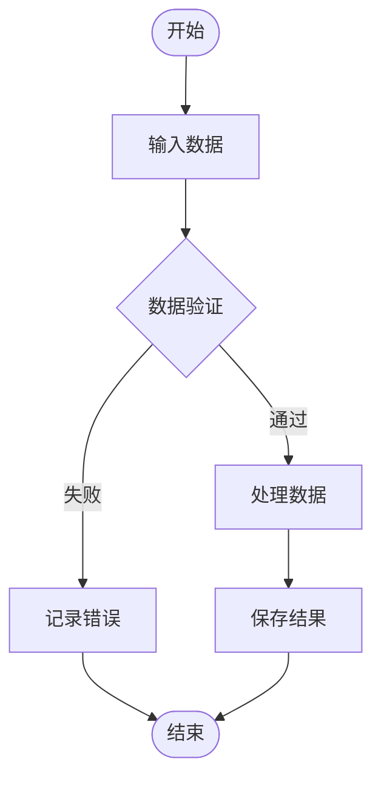

### 系统架构图模板

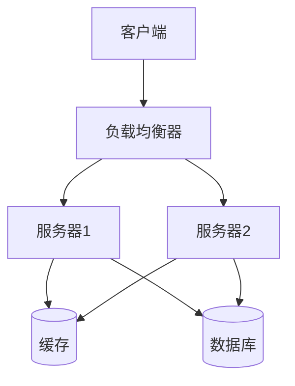

### API 序列图模板

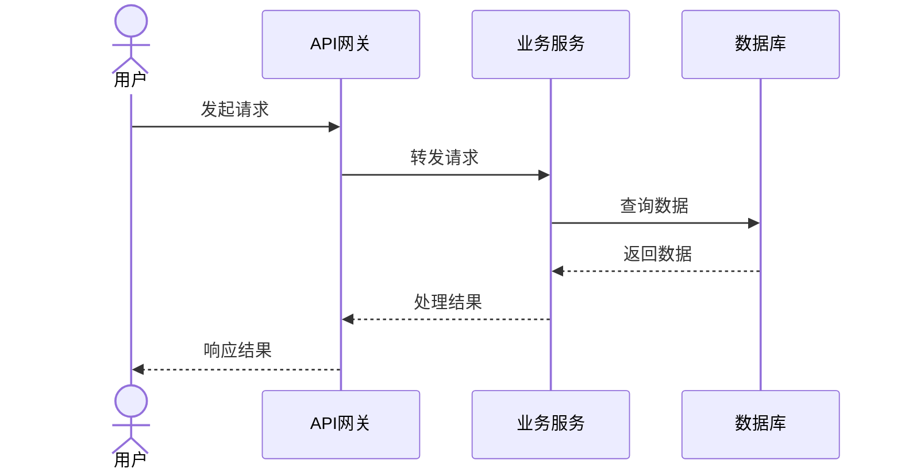

## 资源链接

- 官方文档: https://mermaid.js.org/
- 在线编辑器: https://mermaid.live
- GitHub: https://github.com/mermaid-js/mermaid
- 语法文档: https://mermaid.js.org/syntax/reference.html

## 更新日志

- v1.0.0 - 初始版本，支持基本的图表生成
